

  
   
  <picture><source media="(max-width: 767px)" srcset="assets/m/hero.svg" /></picture>
   
  <picture><source media="(max-width: 767px)" srcset="assets/m/tagline.svg" /></picture>

  <a href="#evidence-trail"><b>Evidence</b></a> ·
  <a href="#product-portfolio"><b>Products</b></a> ·
  <a href="#explore-powv"><b>Explore</b></a> ·
  <a href="#demos"><b>Demos</b></a> ·
  <a href="#repositories"><b>Repositories</b></a> ·
  <a href="#verify-it"><b>Verify It</b></a> ·
  <a href="#dispute-it"><b>Dispute It</b></a> ·
  <a href="#stack"><b>Stack</b></a> ·
  <a href="#activity"><b>Activity</b></a> ·
  <a href="#contact"><b>Contact</b></a>

## About

Founder and architect of **PoWV Protocol**. I design and build systems that turn physical events (a weight, a measurement, a custody handover) into attributable, verifiable digital evidence, from the serial port of an industrial instrument to an auditable record.

> A signature can show that a record is intact. It cannot show that the physical event happened as recorded. PoWV keeps those two claims separate, and I design every layer around that distinction.

## Evidence trail

<a href="https://github.com/powvprotocol-org/powv-lab-status"><picture><source media="(max-width: 767px)" srcset="assets/m/timeline.svg" />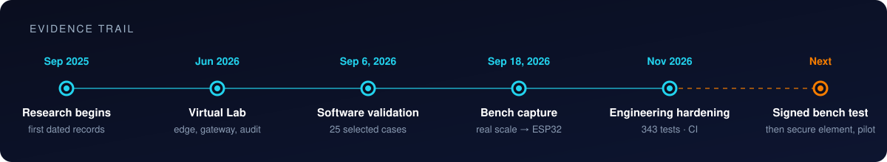</picture></a>

<a href="https://github.com/powvprotocol-org/powv-scale-edge-integration/blob/main/docs/integration-module/experimental-record.md">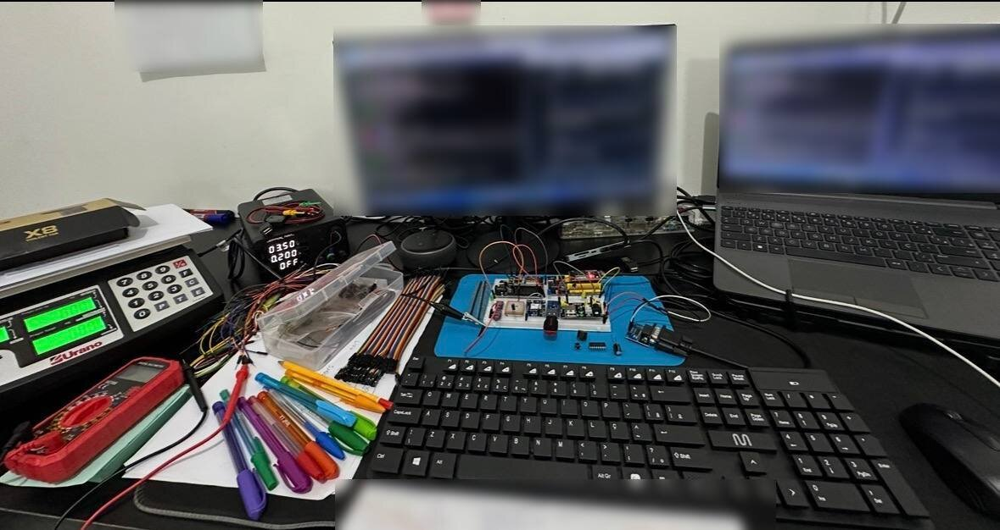</a>

The laboratory bench: a commercial Urano scale, the host computers and the embedded receiver on the breadboard. Screens and handwritten notes are blurred.

## Product portfolio

Three distinct, interoperable products and one profile. None is commercially available yet.

<table>
  <tr>
    <td width="50%"><a href="https://powv-protocol.gitbook.io/powv-protocol-docs/product-proposals/protocol-suite"><picture><source media="(max-width: 767px)" srcset="assets/m/card-protocol-suite.svg" /></picture></a></td>
    <td width="50%"><a href="https://powv-protocol.gitbook.io/powv-protocol-docs/product-proposals/edgeguard"><picture><source media="(max-width: 767px)" srcset="assets/m/card-edgeguard.svg" /></picture></a></td>
  </tr>
  <tr>
    <td width="50%"><a href="https://powv-protocol.gitbook.io/powv-protocol-docs/product-proposals/secure-capture-node"><picture><source media="(max-width: 767px)" srcset="assets/m/card-secure-capture-node.svg" /></picture></a></td>
    <td width="50%"><a href="https://powv-protocol.gitbook.io/powv-protocol-docs/product-proposals/edgeguard/digital-treasury"><picture><source media="(max-width: 767px)" srcset="assets/m/card-digital-treasury.svg" /></picture></a></td>
  </tr>
</table>

<a href="https://powv-protocol.gitbook.io/powv-protocol-docs/product-proposals/trust-boundaries"><picture><source media="(max-width: 767px)" srcset="assets/m/layers.svg" /></picture></a>

<picture><source media="(max-width: 767px)" srcset="assets/m/thesis.svg" />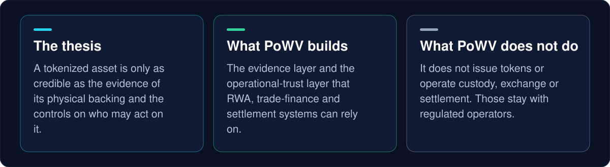</picture>

<table>
  <tr>
    <td width="33%"><a href="https://powv-protocol.gitbook.io/powv-protocol-docs/product-proposals/trust-boundaries"><picture><source media="(max-width: 767px)" srcset="assets/m/link-boundaries.svg" />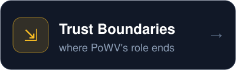</picture></a></td>
    <td width="33%"><a href="https://github.com/powvprotocol-org/protocol-economic-finality"><picture><source media="(max-width: 767px)" srcset="assets/m/link-finality.svg" />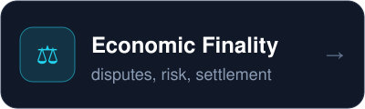</picture></a></td>
    <td width="33%"><a href="https://github.com/powvprotocol-org/powv-investment-and-governance"><picture><source media="(max-width: 767px)" srcset="assets/m/link-investment.svg" /></picture></a></td>
  </tr>
</table>

## Explore PoWV

Where to go, depending on what you want to check.

<table>
  <tr>
    <td width="50%"><a href="https://powv-protocol.gitbook.io/powv-protocol-docs/overview"><picture><source media="(max-width: 767px)" srcset="assets/m/tile-what.svg" /></picture></a></td>
    <td width="50%"><a href="https://github.com/powvprotocol-org/powv-lab-status"><picture><source media="(max-width: 767px)" srcset="assets/m/tile-demonstrated.svg" /></picture></a></td>
  </tr>
  <tr>
    <td width="50%"><a href="https://powv-protocol.gitbook.io/powv-protocol-docs/product-proposals/"><picture><source media="(max-width: 767px)" srcset="assets/m/tile-products.svg" /></picture></a></td>
    <td width="50%"><a href="https://powv-protocol.gitbook.io/powv-protocol-docs/product-proposals/trust-boundaries"><picture><source media="(max-width: 767px)" srcset="assets/m/tile-boundaries.svg" /></picture></a></td>
  </tr>
  <tr>
    <td width="50%"><a href="https://github.com/powvprotocol-org/powv-investment-and-governance/blob/main/docs/09-commercial-strategy/README.md"><picture><source media="(max-width: 767px)" srcset="assets/m/tile-market.svg" />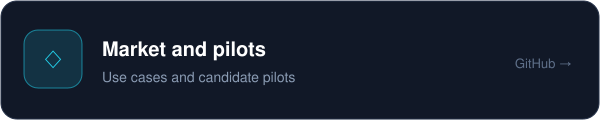</picture></a></td>
    <td width="50%"><a href="https://github.com/powvprotocol-org/powv-investment-and-governance"><picture><source media="(max-width: 767px)" srcset="assets/m/tile-investment.svg" /></picture></a></td>
  </tr>
  <tr>
    <td width="50%"><a href="https://github.com/powvprotocol-org/protocol-economic-finality"><picture><source media="(max-width: 767px)" srcset="assets/m/tile-finality.svg" />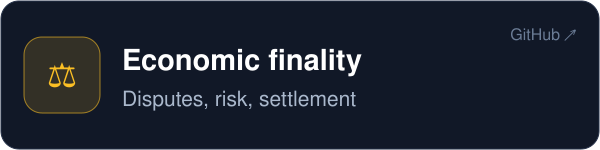</picture></a></td>
    <td width="50%"><a href="https://powv-protocol.gitbook.io/powv-protocol-docs/security/disclosure-boundary"><picture><source media="(max-width: 767px)" srcset="assets/m/tile-security.svg" />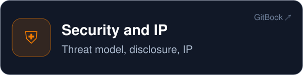</picture></a></td>
  </tr>
</table>

## Demos

<table>
  <tr>
    <td width="50%"><a href="https://github.com/GabsDevX/proof-of-weighted-value">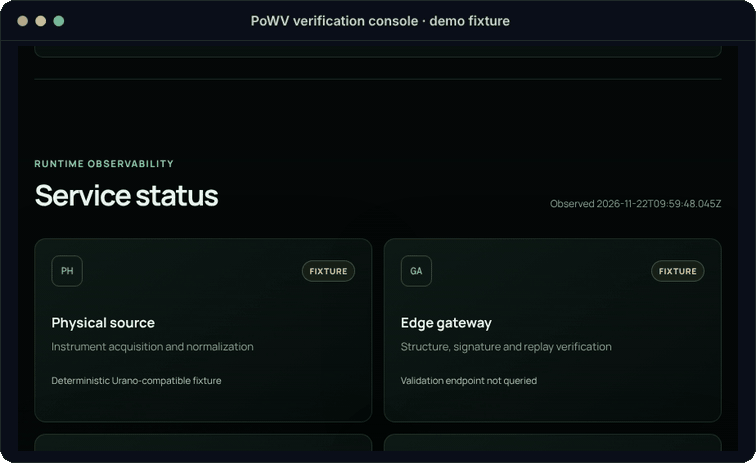</a> <strong>Verification console</strong> service status and stages</td>
    <td width="50%"><a href="https://github.com/GabsDevX/proof-of-weighted-value">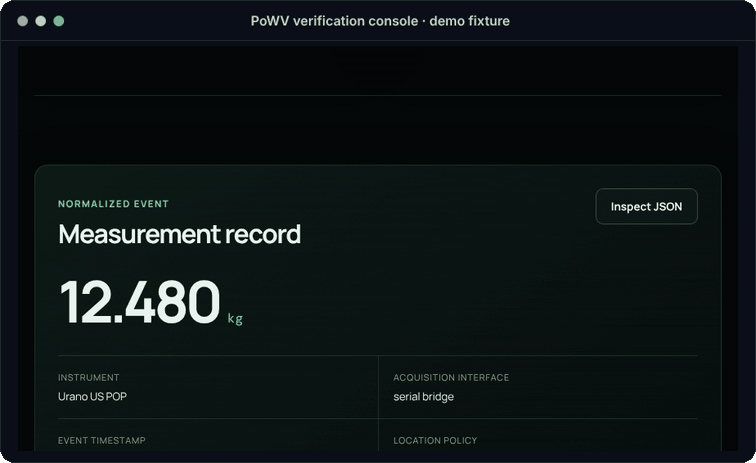</a> <strong>Event record</strong> a measurement and its JSON</td>
  </tr>
  <tr>
    <td width="50%"><a href="https://github.com/GabsDevX/proof-of-weighted-value"></a> <strong>Console build</strong> type check, build, audit</td>
    <td width="50%"><a href="https://github.com/powvprotocol-org/powv-scale-edge-integration/blob/main/docs/integration-module/experimental-record.md">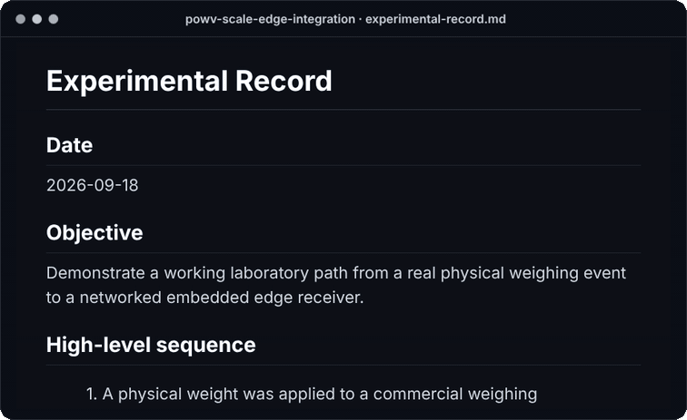</a> <strong>Bench record</strong> September 18, 2026</td>
  </tr>
</table>

The console runs on a deterministic demo fixture; no operational measurement or signature result is shown.

## Repositories

Every public repository, by theme: evidence, architecture, investment and security.

<table>
  <tr>
    <td width="33%"><a href="https://github.com/powvprotocol-org/powv-lab-status"><picture><source media="(max-width: 767px)" srcset="assets/m/repo-01.svg" />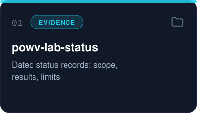</picture></a></td>
    <td width="33%"><a href="https://github.com/powvprotocol-org/powv-scale-edge-integration"><picture><source media="(max-width: 767px)" srcset="assets/m/repo-02.svg" />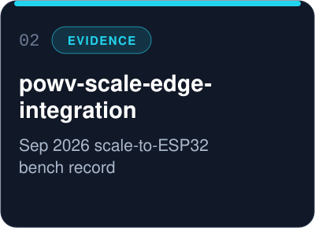</picture></a></td>
    <td width="33%"><a href="https://github.com/GabsDevX/proof-of-weighted-value"><picture><source media="(max-width: 767px)" srcset="assets/m/repo-03.svg" />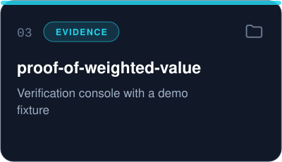</picture></a></td>
  </tr>
  <tr>
    <td width="33%"><a href="https://github.com/powvprotocol-org/powv-governance-and-docs"><picture><source media="(max-width: 767px)" srcset="assets/m/repo-04.svg" />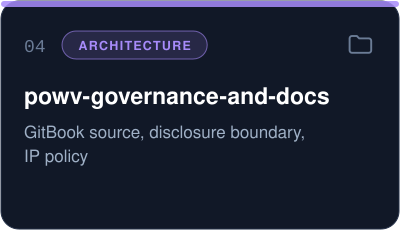</picture></a></td>
    <td width="33%"><a href="https://github.com/powvprotocol-org/powv-core"><picture><source media="(max-width: 767px)" srcset="assets/m/repo-05.svg" />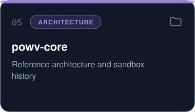</picture></a></td>
    <td width="33%"><a href="https://github.com/powvprotocol-org/powv-investment-and-governance"><picture><source media="(max-width: 767px)" srcset="assets/m/repo-06.svg" />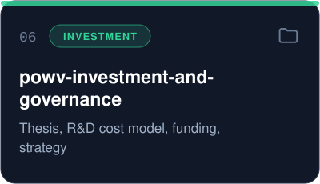</picture></a></td>
  </tr>
  <tr>
    <td width="33%"><a href="https://github.com/powvprotocol-org/protocol-economic-finality"><picture><source media="(max-width: 767px)" srcset="assets/m/repo-07.svg" />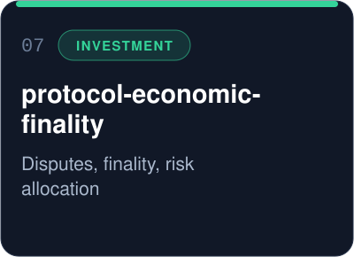</picture></a></td>
    <td width="33%"><a href="https://github.com/powvprotocol-org/powv-embedded-security"><picture><source media="(max-width: 767px)" srcset="assets/m/repo-08.svg" />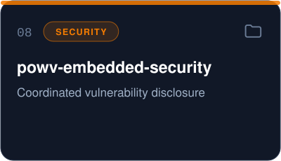</picture></a></td>
    <td width="33%"><a href="https://github.com/powvprotocol-org/powvprotocol-org.github.io"><picture><source media="(max-width: 767px)" srcset="assets/m/repo-09.svg" />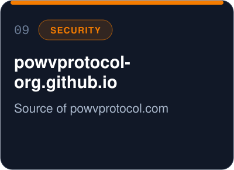</picture></a></td>
  </tr>
</table>

## How I work

<picture><source media="(max-width: 767px)" srcset="assets/m/principles.svg" />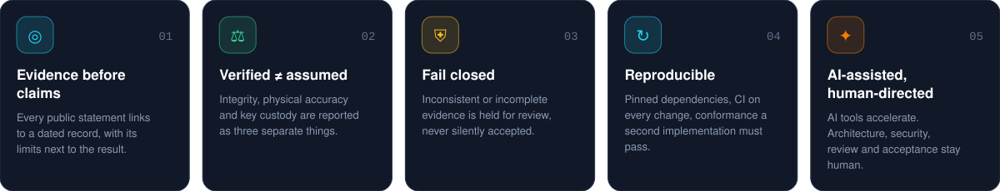</picture>

## Verify It

<picture><source media="(max-width: 767px)" srcset="assets/m/verify-it.svg" /></picture>

Illustrative walkthrough. Pseudocode, not project source; reading values are examples.

## Dispute It

<a href="https://github.com/powvprotocol-org/protocol-economic-finality"><picture><source media="(max-width: 767px)" srcset="assets/m/dispute-it-v2.svg" /></picture></a>

**Outcome:** only the payment is suspended, then settled once. Ownership and the lot itself are never in question.

Proposed architecture from the public economic-finality research. No bond amounts, deadlines or slashing rules are defined here.

## Stack

<picture><source media="(max-width: 767px)" srcset="assets/m/stack.svg" /></picture>

## Activity

<picture><source media="(max-width: 767px)" srcset="https://raw.githubusercontent.com/GabsDevX/GabsDevX/activity/activity-mobile.svg" />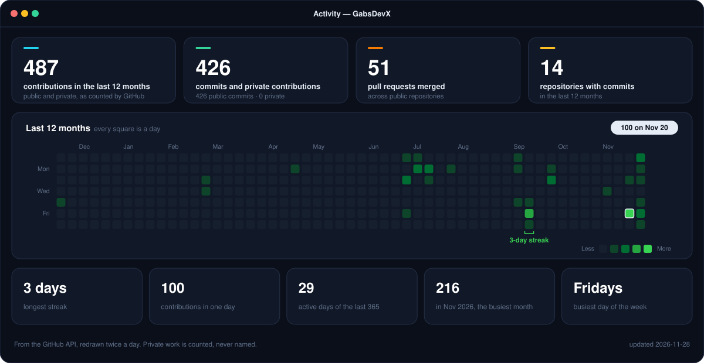</picture>

## Contact

<table>
  <tr>
    <td width="33%"><a href="mailto:gabriel@powvprotocol.com"><picture><source media="(max-width: 767px)" srcset="assets/m/contact-email.svg" /></picture></a></td>
    <td width="33%"><a href="https://www.powvprotocol.com"><picture><source media="(max-width: 767px)" srcset="assets/m/contact-website.svg" /></picture></a></td>
    <td width="33%"><a href="https://powv-protocol.gitbook.io/powv-protocol-docs/overview"><picture><source media="(max-width: 767px)" srcset="assets/m/contact-docs.svg" /></picture></a></td>
  </tr>
  <tr>
    <td width="33%"><a href="https://github.com/powvprotocol-org"><picture><source media="(max-width: 767px)" srcset="assets/m/contact-github.svg" /></picture></a></td>
    <td width="33%"><a href="https://www.linkedin.com/in/gabriel-protocolpowv/"><picture><source media="(max-width: 767px)" srcset="assets/m/contact-linkedin.svg" /></picture></a></td>
    <td width="33%"><a href="https://www.linkedin.com/company/powv-protocol/"><picture><source media="(max-width: 767px)" srcset="assets/m/contact-linkedin-co.svg" /></picture></a></td>
  </tr>
  <tr>
    <td width="33%"><a href="https://www.youtube.com/@GabrielProtocolPowv"><picture><source media="(max-width: 767px)" srcset="assets/m/contact-youtube.svg" /></picture></a></td>
    <td width="33%"><a href="https://powvprotocol.substack.com/"><picture><source media="(max-width: 767px)" srcset="assets/m/contact-substack.svg" /></picture></a></td>
    <td width="33%"><a href="https://orcid.org/0000-0002-3415-4484"><picture><source media="(max-width: 767px)" srcset="assets/m/contact-orcid.svg" /></picture></a></td>
  </tr>
</table>

<picture><source media="(max-width: 767px)" srcset="assets/m/contact-footer.svg" /></picture>

© 2025–2026 Gabriel de Almeida Santos Silva · PoWV Protocol™ · All rights reserved. Rights holder and IP terms: <a href="https://github.com/powvprotocol-org/powv-governance-and-docs/blob/main/TRADE_SECRET_POLICY.md">Trade Secret and IP Policy</a>.

  

