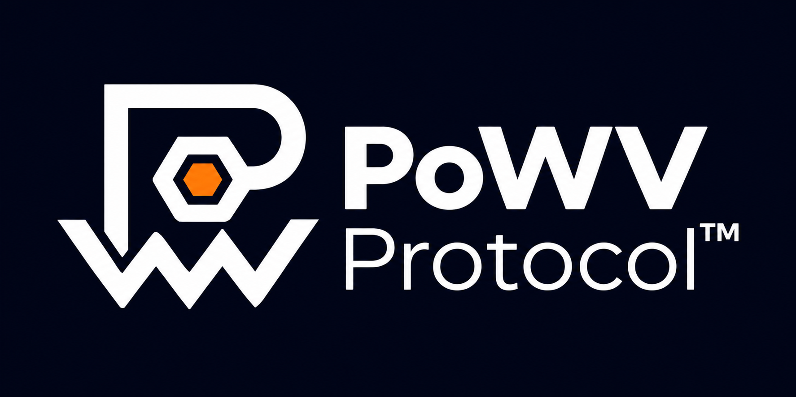
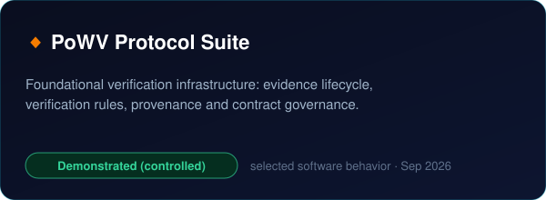
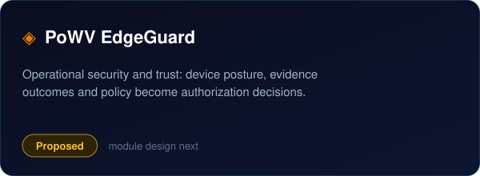
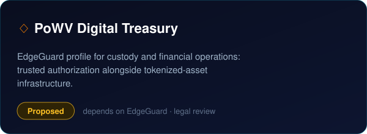
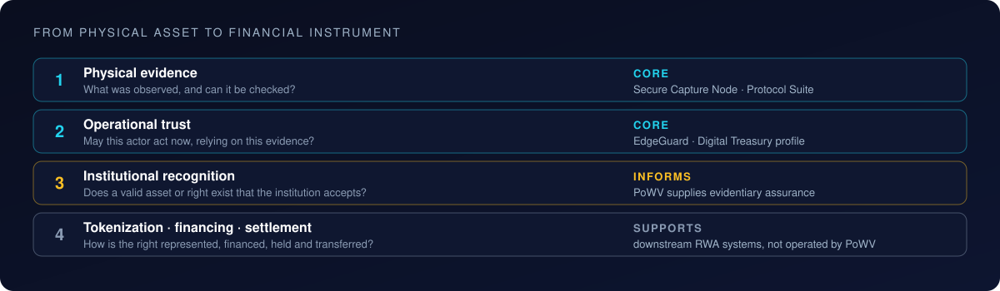

  
    
  
   
  

## About

Founder and architect of **PoWV Protocol**. I design and build systems that turn physical events (a weight, a measurement, a custody handover) into attributable, verifiable digital evidence, from the serial port of an industrial instrument to an auditable record.

> A signature can show that a record is intact. It cannot show that the physical event happened as recorded. PoWV keeps those two claims separate, and I design every layer around that distinction.

## Evidence trail

## Product portfolio

Three distinct, interoperable products and one profile. Names describe intended roles; none is commercially available yet.

<table>
  <tr>
    <td width="50%"></td>
    <td width="50%"></td>
  </tr>
  <tr>
    <td width="50%"></td>
    <td width="50%"></td>
  </tr>
</table>

## From physical asset to financial instrument

The economic thesis covers real-world asset (RWA) tokenization, trade finance and settlement. A tokenized asset is only as credible as the evidence of its physical backing and the controls on who may act on it. PoWV builds those two layers. It does not issue tokens or operate custody, exchange or settlement. The related research on dispute governance, economic finality and risk allocation is public: [Trust Boundaries](https://powv-protocol.gitbook.io/powv-protocol-docs/product-proposals/trust-boundaries) · [Economic Finality & Dispute Governance](https://github.com/powvprotocol-org/protocol-economic-finality) · [Investment & Governance](https://github.com/powvprotocol-org/powv-investment-and-governance).

## Explore PoWV

Where to go, depending on what you want to check. Each tile opens the primary record.

<table>
  <tr>
    <td width="50%"></td>
    <td width="50%"></td>
  </tr>
  <tr>
    <td width="50%"></td>
    <td width="50%"></td>
  </tr>
  <tr>
    <td width="50%"></td>
    <td width="50%"></td>
  </tr>
  <tr>
    <td width="50%"></td>
    <td width="50%"></td>
  </tr>
</table>

<strong>How I work</strong>

- **Evidence before claims.** Every public statement links to a dated record, and its limits are written next to the result.
- **Separate what is verified from what is assumed.** Integrity, physical accuracy and key custody are reported as three different things.
- **Fail closed.** Inconsistent or incomplete evidence is held for review, never silently accepted.
- **Reproducibility.** Pinned dependencies, CI on every change, and conformance tests that a second implementation must pass.
- **AI-assisted, human-directed.** I use AI coding tools as accelerators. Architecture, security decisions, review and acceptance remain mine.

<strong>Status and roadmap</strong>

| Stage | Status |
| --- | --- |
| Laboratory proof of concept: bench capture and selected software validation (Sep 2026) | Complete |
| Engineering hardening: audit integrity, conformance, admissibility (Nov 2026, experimental) | In progress |
| Physical bench test of the signed capture path | Next |
| Hardware secure element for device identity | Planned |
| Controlled industrial pilot | Planned |

No product is commercially available yet.

## Stack

Evidence: [Bench record, Sep 2026](https://github.com/powvprotocol-org/powv-scale-edge-integration/blob/main/docs/integration-module/experimental-record.md) · [Engineering update, Nov 2026](https://github.com/powvprotocol-org/powv-lab-status/blob/main/status/2026-11-software-engineering-update.md) · Backend and audit code in a private repository, available under NDA.

## Activity

  
  

## Contact

  
  
  
  
  
  

**gabriel@powvprotocol.com** · Open to technical walkthroughs, research partnerships and pilot discussions. Confidential material is shared under NDA.

© 2025–2026 Gabriel de Almeida Santos Silva · PoWV Protocol™ · All rights reserved. Rights holder and IP terms: <a href="https://github.com/powvprotocol-org/powv-governance-and-docs/blob/main/TRADE_SECRET_POLICY.md">Trade Secret and IP Policy</a>.

  

