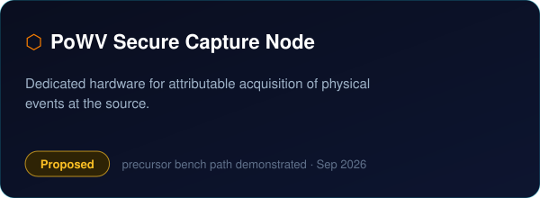
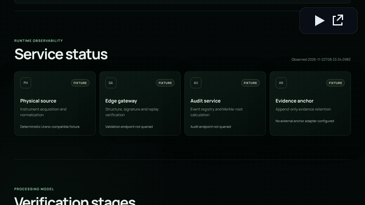
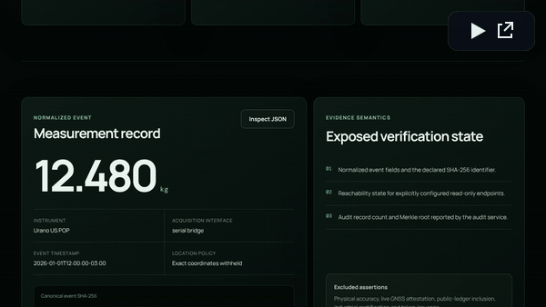
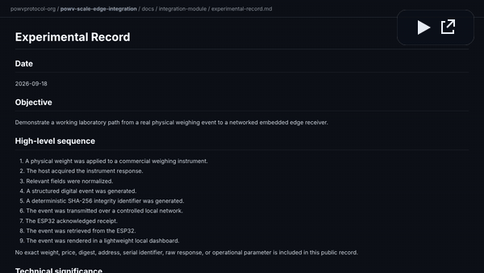

  
    
  
   
  

## About

Founder and architect of **PoWV Protocol**. I design and build systems that turn physical events (a weight, a measurement, a custody handover) into attributable, verifiable digital evidence, from the serial port of an industrial instrument to an auditable record.

> A signature can show that a record is intact. It cannot show that the physical event happened as recorded. PoWV keeps those two claims separate, and I design every layer around that distinction.

## Evidence trail

## Product portfolio

Three distinct, interoperable products and one profile. Names describe intended roles; none is commercially available yet.

<table>
  <tr>
    <td width="50%"></td>
    <td width="50%"></td>
  </tr>
  <tr>
    <td width="50%"></td>
    <td width="50%"></td>
  </tr>
</table>

## From physical asset to financial instrument

The economic thesis covers real-world asset (RWA) tokenization, trade finance and settlement. A tokenized asset is only as credible as the evidence of its physical backing and the controls on who may act on it. PoWV builds those two layers. It does not issue tokens or operate custody, exchange or settlement. The related research on dispute governance, economic finality and risk allocation is public: [Trust Boundaries](https://powv-protocol.gitbook.io/powv-protocol-docs/product-proposals/trust-boundaries) · [Economic Finality & Dispute Governance](https://github.com/powvprotocol-org/protocol-economic-finality) · [Investment & Governance](https://github.com/powvprotocol-org/powv-investment-and-governance).

## Explore PoWV

Where to go, depending on what you want to check. Each tile opens the primary record.

<table>
  <tr>
    <td width="50%"></td>
    <td width="50%"></td>
  </tr>
  <tr>
    <td width="50%"></td>
    <td width="50%"></td>
  </tr>
  <tr>
    <td width="50%"></td>
    <td width="50%"></td>
  </tr>
  <tr>
    <td width="50%"></td>
    <td width="50%"></td>
  </tr>
</table>

<strong>Demos</strong> · recordings from the repositories

 

<table>
  <tr>
    <td width="50%"> <strong>Verification console</strong> · service status and verification stages</td>
    <td width="50%"> <strong>Event record</strong> · a measurement and its inspectable JSON</td>
  </tr>
  <tr>
    <td width="50%"> <strong>Console build</strong> · type check, production build, dependency audit</td>
    <td width="50%"> <strong>Bench record</strong> · the September 18, 2026 scale-to-ESP32 test</td>
  </tr>
</table>

The console runs on a deterministic demo fixture; no operational measurement or signature result is shown.

<strong>More on the shelf</strong> · every public repository, by theme

 

**Evidence and laboratory**

- [powv-lab-status](https://github.com/powvprotocol-org/powv-lab-status) · dated status records of the private Virtual Lab: scope, results and limits
- [powv-scale-edge-integration](https://github.com/powvprotocol-org/powv-scale-edge-integration) · public record of the September 2026 scale-to-ESP32 bench test
- [proof-of-weighted-value](https://github.com/GabsDevX/proof-of-weighted-value) · verification console with a deterministic demo fixture

**Architecture and documentation**

- [powv-governance-and-docs](https://github.com/powvprotocol-org/powv-governance-and-docs) · canonical GitBook source, disclosure boundary and IP policy
- [powv-core](https://github.com/powvprotocol-org/powv-core) · reference architecture overview and retired sandbox history

**Investment and economic research**

- [powv-investment-and-governance](https://github.com/powvprotocol-org/powv-investment-and-governance) · investment thesis, R&D cost model, funding scenarios and commercial strategy
- [protocol-economic-finality](https://github.com/powvprotocol-org/protocol-economic-finality) · dispute governance, economic finality and risk allocation

**Security and web**

- [powv-embedded-security](https://github.com/powvprotocol-org/powv-embedded-security) · coordinated vulnerability disclosure policy
- [powvprotocol-org.github.io](https://github.com/powvprotocol-org/powvprotocol-org.github.io) · source of powvprotocol.com

## How I work

## Verify It

Illustrative walkthrough of the evidence path. Pseudocode, not project source; reading values are examples.

## Stack

Evidence: [Bench record, Sep 2026](https://github.com/powvprotocol-org/powv-scale-edge-integration/blob/main/docs/integration-module/experimental-record.md) · [Engineering update, Nov 2026](https://github.com/powvprotocol-org/powv-lab-status/blob/main/status/2026-11-software-engineering-update.md) · Backend and audit code in a private repository, available under NDA.

## Activity

  
  

## Contact

  
  
  
  
  

Open to technical walkthroughs, research partnerships and pilot discussions. Confidential material is shared under NDA. 
<a href="https://www.linkedin.com/company/powv-protocol/">PoWV on LinkedIn</a> · <a href="https://www.youtube.com/@GabrielProtocolPowv">YouTube</a> · <a href="https://powvprotocol.substack.com/">Substack</a>

© 2025–2026 Gabriel de Almeida Santos Silva · PoWV Protocol™ · All rights reserved. Rights holder and IP terms: <a href="https://github.com/powvprotocol-org/powv-governance-and-docs/blob/main/TRADE_SECRET_POLICY.md">Trade Secret and IP Policy</a>.

  

